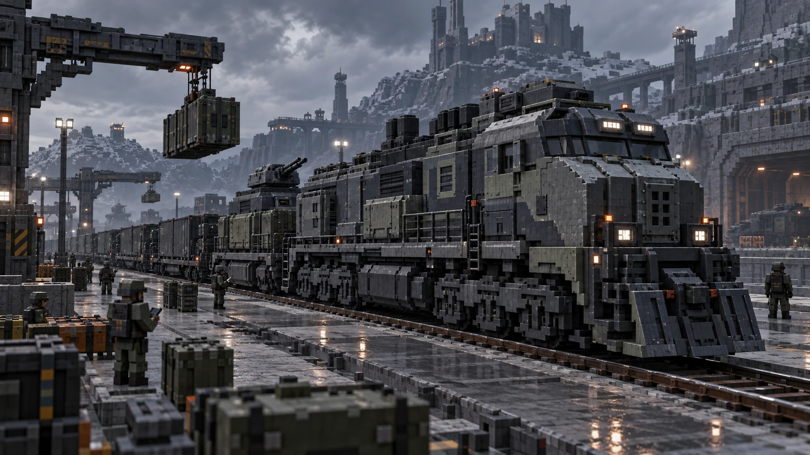
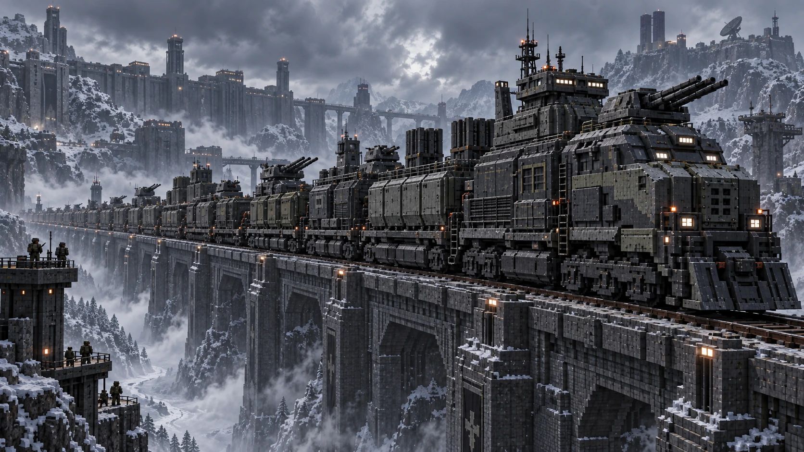

# 00 视觉定位

> 决策出处：美术 Q180、Q184、Q225、Q228，以及讨论中确认的八个关键词。由[迁移美术初稿并建立 docs/art 骨架](https://github.com/odradekk/train/issues/240)从[美术方向初稿](../research/art-direction-draft-2026-10-08.md)第 1 节改写。

## 边界

本文规定游戏整体的视觉基调：关键词、技术时代感和不采用的方向，是其他各篇的出发点。形状、材质、色彩、光照等具体画法见各篇。本文不规定能源、科技树、武器数值或任何玩法规则。

## 不变量

1. **整体是近未来工业文明。** 以现实工程体系的延伸和大型化为主。局部地区或个别内容可以有不同气质，但不能取代整体基调。
2. **外观不授予能力。** 画面上出现接口、设备或武器的造型，不代表对象具备对应能力；能力只来自内容定义和玩法规则。
3. **基调不靠单一手段。** 冷峻不靠压低曝光，写实不靠在每块表面堆划痕，宏大不靠缩小人物或违反正式尺度。
4. **概念图只说明方向。** 概念图用来判断现代感、重量感和工业气氛，不证明尺寸、占格、资产精度或性能。

## 规则

### 核心定义

游戏使用近未来工业的美术语言：体素网格和低面数几何决定构造方式，材质和光照追求物理上可信的质感（美术 Q225），渲染器为 Forward+（决策笔记 `2026-10-09-render-with-forward-plus`）；复杂的车辆、建筑和机械由一套可复用、在游戏中可获得、可改装的体素组合而成。光照与效果见 [05](05-lighting-and-readability.md)。

### 八个关键词

| 关键词 | 画面上的含义 |
| --- | --- |
| Industrial · 工业 | 动力、散热、检修、装卸与连接结构明确可见 |
| Monumental · 宏大 | 用长编组、厚重的车体、基础设施和尺度参照表现宏大 |
| Utilitarian · 功能优先 | 形状服务于用途；不靠无意义的装饰尖刺和空壳塔楼制造复杂感 |
| Modular · 模块化 | 可替换的装甲、标准接头、安装座和可复用的体素定义形成统一的构造方式 |
| Cold · 冷峻 | 理性、严肃、克制，不等于永久黑暗、永久雪景或全世界去色 |
| Restrained · 节制 | 细节分主次，默认涂装和灯光克制，不让所有表面同时抢眼 |
| Heavy · 厚重 | 车架、装甲厚度、轮组、承载结构与设备的分量清楚可见 |
| Engineered · 工程可信 | 部件和结构看起来能安装、维护和替换，支撑、接口与检修路径有可读的设计意图 |

### 技术时代感

- 动力以电传动为主，配合多样的发电、充电和补能方式（美术 Q180）。具体技术树、能源模型和设备规则由玩法设计决定；外观上出现某种接口，不等于已经具备对应能力。
- 武器以传统火炮、自动武器、火箭、导弹、无人设备和电子设备的工程延伸为主，可以保留少量尖端技术（美术 Q184）。讨论中的“95% / 5%”只表示主次，不是内容配额，也不承诺逐项实现。

### 自然环境

冷峻的是工业产品，不是整个世界。地貌和植被保留丰富的色彩（美术 Q228），不做成全世界蓝灰、永远冬季或完全去色；有哪些地貌见 [05](../design/05-world-graph-and-generation.md)。

### 不采用的方向

不以温馨的蒸汽玩具、童话小镇、哥特宗教军事、全域废土锈蚀或炫光能量科技作为基础风格。

### 参考图

*参考图 A：讨论中生成并被接受的概念方向，用来判断现代感、重量感和工业气氛。图中的雪景、阴天、重武装和高密度细节不要求在所有场景重复。*

*参考图 B：后期长编组的宏大感。车体比例、炮塔大小、轨道与桥梁尺寸仍以正式内容和场景规则为准，不要求复刻图中细节。*

## 本阶段

各类资产按六阶段交付，见[资产制作流程](08-asset-pipeline-and-review.md#本阶段)。

## Demo 范围

本文的基调适用于 Demo 的全部画面，但不因此扩大 Demo 的实现范围。

## Demo 之后

无。

## 开放问题

无。
