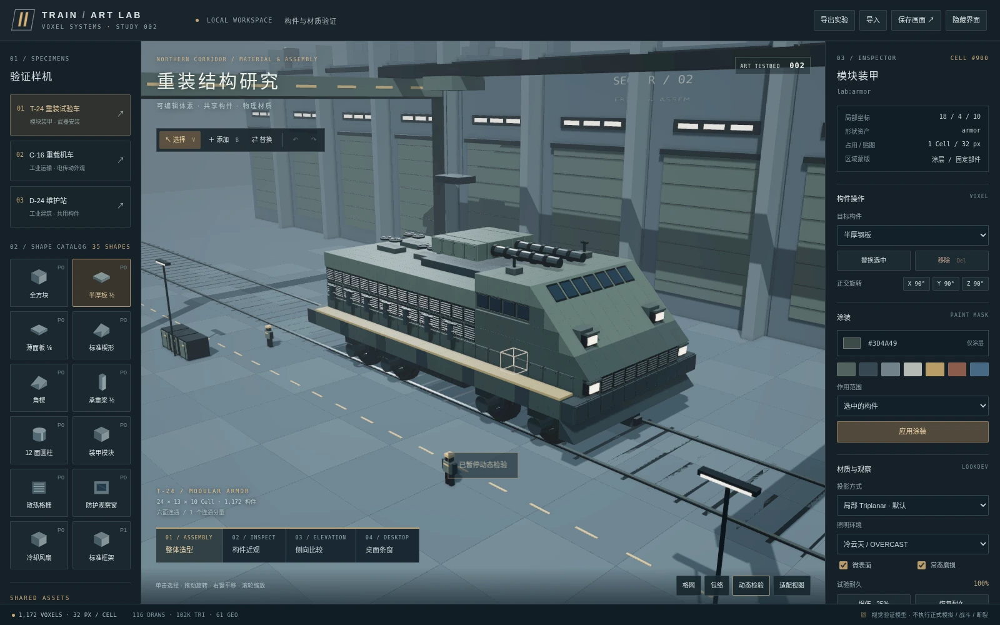

# 美术方向初稿（2026-10-08）

> 来源：2026-10-08 美术讨论整理稿的规则正文（原 `18-art-direction.md`，作为设计文档第 18 章起草）。本文由整理稿 `TRAIN-Art-Design-v1.0.html` 的阅读版转写成 Markdown，正文文字未作修改；原 Markdown 文件已在迁移后删除。转写时去掉了封面统计和页内链接：正文中的“GDD-README”“GDD-01”等指 `docs/design/` 的对应文档，“美术决定记录”指[美术讨论决定记录](art-grilling-decisions.md)，“架构衔接说明”指该记录末尾的衔接说明，“参考图与证据索引”指[美术参考与原型证据](../../archive/prototypes/art-reference-v1/README.md)。
>
> 本文是历史初稿，不是现行规则。现行规则见[美术设计文档](../art/README.md)，由地图[美术设计文档：整理初稿，建成 docs/art](https://github.com/odradekk/train/issues/239)逐节改写；初稿与当前设计文档、代码的冲突清单见[该地图的第一条评论](https://github.com/odradekk/train/issues/239#issuecomment-6074859885)。

依据已确认讨论与初步验收整理；已核对当前 GDD。概念目标、原型证据与正式实现分别标注。

> **所属层**：内容、美术制作、体素引擎层与渲染层；不定义新的核心模拟规则。
> 
> **版本**：1.0 · 2026-10-08。
> 
> **状态**：本次美术讨论的方向与规则已确认；Voxel Art Testbed 002 已获用户初步验收通过。正式游戏实现、完整资产质量与性能仍须分阶段验收。
> 
> **决策出处**：本次美术 grilling Q180–Q240，本文统一记为“美术 Qn”或 `ART-Qn`，避免与原 GDD 转录、资源与生产转录的同号问题混淆。完整索引见美术决定记录。
> 
> **架构基线**：核对了 2026-10-08 仓库 `docs/design` 的当前内容。讨论期间沿用的旧世界模型、旧尺寸和桌面停靠假设，不作为本章的现行实现契约；差异见架构衔接说明。

**核心定义**：Train 使用近未来工业美术语言。体素网格与低面数几何决定构造方式，较写实、物理可信的材质与光照决定质感；复杂车辆、建筑与机械由一套可复用、可获得、可改装的构件组合而成。

参考图 A：本次生成并被接受的概念方向。用于判断现代性、重量感与工业气氛；不是资产精度、合法占格、尺寸或渲染性能的证明。图中的雪景、阴天、重武装和高密度细节不要求在所有场景重复。

## 边界

本文指导基础形状、通用结构块、功能件、车辆与建筑蓝图、表面材质、涂装、光照、损伤表现及美术验证。目标不是穷举全部资产，而是让开发者、玩家和 AI 使用同一种构造语言，并让后续制作有明确的取舍依据。

本章不设计能源平衡、弹药与武器数值、核心伤害算法、贸易、经济、角色通行、骨骼系统、正式编辑器全套交互或生产存档格式。新美术目标不自动扩大当前开发里程碑或 Demo 的实现范围。

### 当前架构的解释边界

现行核心模拟层不保存全局体素世界，也不逐格模拟整车结构。体素布局属于蓝图与局部场景；核心通过设计属性、部件耐久、结构耐久等状态推进游戏，场景和渲染负责表现。GDD-README

因此，本轮讨论中的“复合体 / Composite”在本章主要指**由体素构成的车辆、建筑或装配体**，不要求恢复旧的 `CompositeInstance + Owned Voxels` 运行时模型。损伤、身份、编组、蓝图版本与存档均按当前 GDD 衔接。GDD-03

| 本章负责 | 由其他契约负责 |
| --- | --- |
| 看起来由哪些构件组成，形状与材质如何统一 | 核心保存何种状态、设计属性如何派生 |
| 设备功能如何在轮廓上可读 | 能力、伤害、能源、速度和生产的具体算法 |
| 损伤怎样被看见，如何避免与真实状态矛盾 | 哪个部件受损、结构剩余多少、对象是否摧毁 |
| 涂层区域、颜色、纹理密度和映射 | 版本、内容目录、存档与热重载格式 |
| 低屏幕覆盖率下的可读性 | 产品窗口形态、正式相机与界面交互 |

## 不变量

- **构造一致**：所有车辆与建筑的组成块都来自游戏中可获得的构件；不得依赖开发者专属、玩家永远无法获得的“外壳块”或整车特权模型。可获得不等于开局全部拥有。场景专用地形与装饰另按 `scene_only` 规则管理，不混入玩家设计零件库。GDD-02

- **形状不等于玩法**：Shape 是可复用表现资产，不保存质量、耐久、能力或独立游戏身份。具体用途由 `VoxelDefinition` 及已注册 Behavior 表达。

- **一格一块**：一个 Voxel 占一个完整逻辑 Cell，同一网格的一个 Cell 最多一个 Voxel。半块、薄板、管道和镂空框架都不允许在余下空间再放第二个 Voxel。

- **普通模型严格内接**：通用 Shape、普通 Custom Mesh，以及普通格内动画的扫掠包络，均不得越出所属 Cell。跨格连续几何或运动结构进入明确的 Specialized 表现路径，而不是普通资产的随意越界例外。

- **安装方向正交**：布局使用整数坐标，安装朝向只取定义允许的立方体正交朝向。24 向是完整上限，不代表每个构件都必须开放全部方向。GDD-01

- **视觉与合法性分离**：占格、碰撞、视觉接触、遮挡和六面连通分别处理。Mesh 没接触的外观问题可警告；真正违反占格、包络或设计连通规则，仍应由正式校验拒绝。

- **标准比例**：游戏中使用经过定义的标准形状与固定比例变体，不开放任意缩放来绕过单格边界或车辆包络。

- **基础密度统一**：基础表面以 **32 px / Voxel** 为名义纹理密度。铭牌、文字、屏幕等信息纹理允许例外；共享微表面可以独立提供，但必须克制、可过滤。

- **材质偏写实**：真实的是材料质感、光照与反射关系；不因此要求高细分几何、照片级纹理噪声或全屏像素化滤镜。

- **涂装不重写材质身份**：玩家颜色作用于可涂装区域，不将玻璃、裸金属、橡胶、光源等全部统一染色；不从颜色推导玩法属性。

- **状态单向驱动表现**：Damage 由真实核心状态驱动；常态 Wear、粒子、网格动画和其他纯表现不回写模拟结果。

- **通过范围不外推**：概念图、Three.js 原型、自动检查和人工验收分别证明各自观察的范围。原型初步通过不等于生产资产、Godot 集成或规模性能通过。

## 规则

### 1. 视觉定位与科技基调

**出处：美术 Q180–Q190、Q216、Q225、Q227–Q229。**

#### 1.1 八个核心关键词

| 关键词 | 可执行的视觉含义 |
| --- | --- |
| Industrial · 工业 | 动力、散热、检修、装卸与连接结构明确可见 |
| Monumental · 宏大 | 通过连续编组、厚重体量、基础设施和尺度参照建立恢宏感 |
| Utilitarian · 功能优先 | 形状服务于用途；不靠无意义的装饰尖刺和空壳塔楼制造复杂性 |
| Modular · 模块化 | 可替换装甲、标准接头、安装座和可复用构件形成一致语言 |
| Cold · 冷峻 | 理性、严肃、克制，不等于永久黑暗、永久雪景或全世界去色 |
| Restrained · 节制 | 细节有层级，默认涂装与灯光克制，避免所有表面争夺注意力 |
| Heavy · 厚重 | 车架、装甲厚度、轮组、承载与设备质量感清楚 |
| Engineered · 工程可信 | 构件看起来可以安装、维护和替换，支撑、接口与维护路径有可读的设计意图 |

基调是**近未来工业文明**，以现实工程体系的延伸与大型化为主。电传动、多样发电／充电／补能方式属于已认可的方向；具体技术树、能源模型和设备工作规则由相应玩法设计确定，不因外观上出现接口就自动具备能力。

主流武器参考传统火炮、自动武器、火箭、导弹、无人设备和电子设备的工程延伸；少量尖端技术可以保留。此前“95% / 5%”表达的是主次关系，不是必须统计的内容配额，也不构成逐项武器实现承诺。

#### 1.2 不采用的默认方向

不以温馨蒸汽玩具、童话小镇、哥特宗教军事、全域废土锈蚀或炫光能量科技作为基础风格。局部地区或个别内容可以有不同气质，但不能替代整体的近未来工业基调。

冷峻不靠把曝光压低实现；写实不靠把每块表面涂满划痕实现；宏大不靠把人物任意缩小或违反正式尺度实现。

### 2. 用途、成长与列车设计语言

**出处：美术 Q181–Q190、Q197–Q200、Q213–Q215、Q239。**

#### 2.1 用途决定造型，尺寸只决定可用空间

| 造型语言 | 特征 | 典型用途倾向 |
| --- | --- | --- |
| A：铁路机车 | 驾驶室、检修走廊、散热、轮组与货运结构清晰，铁路身份强 | 民用运输、工程、工业服务 |
| B：装甲铁路车辆 | 仍然明显是列车，增加斜面车鼻、局部防护、窄观察窗、强化安装结构 | 防护运输、护卫、军用通用车辆 |
| C：轨道移动设施／战舰 | 宽厚船体式构造、大型设备、多功能上装与连续平台 | 重型战斗、指挥及特殊移动设施 |

民用通常偏 A/B，军用通常偏 B/C；这不是硬性限制。**不得写成“小型必为 A、泰坦必为 C”**。可以有巨型民用工厂车、采矿车或货运车，也可以有小型而高度军事化的侦察车。

#### 2.2 成长通过实际装配产生

内置型号是可使用、可理解的起点：按功能用途安装基本设备，玩家和 AI 获取后，可以依据同一套规则改装、加装和升级。官方不通过隐藏整体模型获得玩家无法复现的外形。

能力辨识首先来自**实际安装的大型设备轮廓**，其次才是涂装、编号与界面。雷达、散热阵列、炮塔、储罐和吊装结构应有不同的大轮廓，而不是只换色或贴图来假装不同功能。装饰造型本身不凭外观授予能力。

玩家可以选择多节泰坦、混合档位或更多小车；本章不规定统一毕业编组，不规定泰坦必须占多数，也不把原型的车辆数量滑杆变成规则。后期能源系统形成软约束是已确认的设计意图，具体平衡效果还需玩法验证，不能仅凭体积推定已经自然限制了车长。

#### 2.3 重量感的结构来源

轮组采用**半暴露式重型机械语言**：能看出车轮、转向架、牵引与制动结构的分组，但允许局部护板。不能把整套行走机构完全抹平，让车体像悬浮盒子；也不要求将每根小管线都独立实体化。

装甲表现为可替换的结构块与模块。斜面、切角、板厚、安装关系比全表面细螺丝更重要。装甲未注册功能性 Behavior 时仍是结构件，不因外观“像设备”而自动变为功能部件。

武器安装可以采用炮塔式、嵌入／炮廓式、垂直模块式三类语言。大型安装座、承重框架等具有实际空间或功能意义的部分可以独立成块；小螺栓、细小接口、格栅条等可属于模型内部细节。美术类别不自动规定射界、瞄准算法或联动伤害。

#### 2.4 泰坦与长编组

泰坦的尺度重点是**长、宽、重与横向延展**，而非无限向上堆塔。单节应有稳定主轮廓；多节组合后，通过上装的功能差异与重复结构形成节奏。压迫感来自多节真实大型载具连续通过，不靠镜头广角夸张替代尺度。

参考图 B：后期长编组的恢宏感意向。具体车体比例、炮塔体积、轨道与桥梁尺寸仍受正式内容与场景契约约束；不要求复刻图中每个细节。

### 3. 尺度、网格与构件定位

**出处：美术 Q192–Q195、Q201–Q205、Q211–Q212；当前尺度来自 GDD-01。**

#### 3.1 三种尺度不能混用

| 层级 | 当前规则 | 不代表 |
| --- | --- | --- |
| 逻辑 Cell | 局部设计网格为 1 × 1 × 1，一格一块 | 一个 Cell 必须由完整 Cube 填满 |
| 物理尺度 | 当前 GDD 为每格边长 0.5 米；人物参照约 3 格高 | 把 Godot 的一个逻辑单位一律解释为现实一米 |
| 美术子网格 | 推荐以 1/8 Cell 量化建模，大形优先使用 1/2、1/4、1/8 比例 | 引入新的 Gameplay 子体素，或让子格独立占用与受损 |

当前车辆尺寸由 GDD-03 维护。编写时为小型 52×7×9、中型 64×10×13、大型 80×14×18、超大型 104×20×26、泰坦 136×30×38 格，均按长×宽×高列出；这是所核对 GDD 的尺度快照，不在美术章建立第二套权威尺寸表。建筑按地块校验，不套车辆档位。

Art Testbed 中的 T-24、C-16、D-24 是实验夹具名称。尤其 T-24 的 24×13×10 格不是当前正式泰坦规格。移植时应按现行尺度重新设计布局，**不能整体缩放旧样机并继续声称每块占一格**。

#### 3.2 局部坐标与旋转

基础 Shape 统一原点、轴向和默认朝向。Slab 等贴面形状默认贴合一个 Cell 边界，通过正交安装旋转复用；不为上下左右重复制作完全相同的资产。

本章不冻结 Blender 到 Godot 的具体轴映射、导出缩放和文件格式；这些应由正式导入管线确定为单一约定，并用边界盒、方向标记和导入回归检查。Testbed 的内部坐标格式不直接成为生产契约。

推荐子网格不是绝对顶点吸附限制：圆周顶点、局部倒角与必要的小细节可以不落在 1/8 格点上，但整体外形、接口和比例仍应保持构件库的一致性，且不突破严格内接边界。

#### 3.3 标准厚度、斜面与曲面

标准厚度采用 **1、1/2、1/4、1/8 Cell** 四档。它们是预制变体；不意味着每种形状都必须制作四套，更不意味着可在同格叠加多块薄板。

斜面优先使用标准楔形、角楔、切角和固定比例过渡件；接头优先使用标准直段与转角。游戏不提供任意缩放、剪切或自由角度来补齐接口。

圆柱、车轮、管道和圆形设备采用低面数曲面。8／12／16 边可作为不同尺度资产的制作起点，不是全库固定面数指标。不能为了“体素风”将所有圆强制做成阶梯，也不能为了“写实”默认把所有曲面细分到近似 CAD 光滑。

### 4. 构件分类与 Shape Catalog

**出处：美术 Q191–Q210、Q214–Q215、Q234–Q239。**

#### 4.1 资产层次

| 层次 | 负责内容 | 示例 |
| --- | --- | --- |
| Shape Asset | 可复用几何、标准比例、局部坐标与表现分区 | Cube、Wedge、Beam、Cylinder |
| 表现材质与映射 | 基础表面、可涂层区域、采样与纹理投影 | 涂装钢壳、混凝土、玻璃 |
| VoxelDefinition | 构件身份、质量、耐久上限、Behavior 及表现绑定 | 某类钢梁、装甲块、牵引设备 |
| 蓝图／装配模板 | 多个真实 Voxel 的布局、朝向、设备配置与涂装 | 内置机车、维护建筑、大型设备组合 |

这里只划分责任，不新建一套与当前内容系统并行的 Shape Gameplay、材质玩法系统或实体继承树。

通用造型块不是“无代价皮肤”。它们是有质量、耐久贡献和空间成本的结构构件。按现行 GDD-03，结构体素的耐久上限汇总为整车／整座建筑的结构耐久；带功能性 Behavior 的部件分别跟踪耐久。不得沿用早期说明中“结构块只各自保存 HP、没有共享结构耐久”的旧结论。

#### 4.2 首批几何制作顺序

| 顺序 | Shape | 用途 |
| --- | --- | --- |
| P0 | Cube · 全方块 | 连续主体、填充、墙体和基础结构 |
| P0 | Half Slab · 半块 | 平台、分层外壳、半厚结构 |
| P0 | Thin Panel · 薄板 | 装甲表层、护板和轻薄外壳 |
| P0 | Wedge · 楔形 | 斜面车鼻、装甲、屋顶与过渡 |
| P0 | Corner Wedge · 角楔 | 转角与复合斜面衔接 |
| P0 | Beam · 梁 | 车架、支撑、梁柱 |
| P0 | Cylinder · 圆柱 | 轴、罐体片段、圆形设备基础 |
| P1 | Quarter Slab · 四分之一块 | 补充分层厚度 |
| P1 | Chamfered Block · 切角块 | 工业外壳与边缘处理 |
| P1 | Frame · 框架 | 开放结构、门框、设备固定架 |
| P1 | Straight Pipe · 直管 | 标准管线片段 |
| P1 | Elbow Pipe · 弯管 | 管线转角 |
| P2 | Sphere · 球体 | 特殊设备或圆形外壳 |
| P2 | Cone · 锥体 | 锥形罩、收口和特殊设备 |

P0/P1/P2 是**生产优先级**，不是科技等级、稀有度、强度或正式 Definition ID。具体变体按实际样机需要增加，未被使用的形状不必提前做完。

#### 4.3 通用件与专用件共同生产

基础几何优先通过开发工具参数化生成，游戏中只发布有限、校验过的标准变体。复杂设备可以用 Blender 制作，但同样遵守单格包络、标准安装方向、材质与映射规范。

门窗、散热器、灯具、接口、机械外壳和武器部件不必全部由最简单的球与方块重新拼出；反过来，也不应为每款整车生产大量不可复用的专属细碎块。

**Gameplay 粒度决定独立构件边界**：需要独立安装、替换、损伤或行为时，优先成为独立 Voxel；纯美术细节集成到 Mesh。优先复用是内容原则，不是禁止必要的新构件。新增专用构件仍须遵守玩家可获得的规则。

同一 Shape 可以服务多个具体 Definition，但不批量生成“所有形状 × 所有材料”的完整组合。外观相似不等于质量、耐久或能力相同。

#### 4.4 大型装配与功能粒度

跨多格的大型雷达、炮塔、发电舱或安装架，使用多个真实构件组成，并可提供 Blueprint Stamp 作为批量放置便利工具。模板不是新的运行时所有者，不造成递归嵌套，也不允许一个 Voxel 占多格。

当前 GDD-03 规定功能设备是单格部件、能力由部件汇总。本章允许“多格构成一个大型视觉装置”，但**不以视觉模板引入一套隐藏的多格功能设备规则**。联动工作状态、整体瞄准与损坏后的联动表现，应按正式部件和行为语义接入；未定部分不能用不可获取的整体外壳掩盖。

装甲与设备共存采用两条明确路径：在相邻 Cell 放置真实外围装甲；或选择同 Cell 内已集成防护的另一设备型号。两者都有相应的空间、质量或规格取舍，禁止同格双重占用。

### 5. 接缝、倒角与连接的可读性

**出处：美术 Q196、Q199、Q206–Q207、Q224、Q226。**

模块边界采用**可读但不刻意强调**的 C 方向。远处先看整体体量与用途，近处再读出装配关系；不沿所有格子画黑线，不把一面连续墙做成棋盘格。

| 构件语义 | 接缝处理 |
| --- | --- |
| 连续地形、墙体与大块混凝土 | 不强制显出每格边界，优先连续体量 |
| 可拆装甲、检修板和设备接口 | 用真实板厚、局部间隙、材料变化和安装结构表达 |
| 梁框与管线 | 靠实际端部、标准接头与结构连接表达 |
| 小型模型内部细节 | 服从主轮廓，不为每条细缝制造强对比 |

倒角按构件类别控制：普通地形 Cube 保持锐利；混凝土克制；机械外壳适量；重型装甲可使用明确切角。不能统一把每个方块缩小并倒角，制造遍布全车的漏缝或塑料积木感。必要倒角可以小于推荐子网格，但仍须内接并通过实际屏幕尺寸检查。

六面相邻而视觉未接触时，可以给设计警告；不得因此创建第二套基于 Mesh 接触的结构合法性。真正不连通的草稿可供编辑，发布与制造仍执行 GDD-03、GDD-15 的正式校验。

渲染遮面也不能只看占格：半块、框架、圆柱或镂空材质占满逻辑格，并不代表视觉上完全遮住邻面；按 GDD-07 的视觉完全遮挡规则处理。

不使用全局黑色描边。AO、接触阴影和材质边缘变化适量使用，不把所有缝隙压成黑洞。选择框、错误提示和调试网格是界面，不受“禁止全局描边”的场景风格限制。

### 6. 写实材质、纹理密度与映射

**出处：美术 Q216–Q217、Q221–Q225、Q231–Q233。**

#### 6.1 材质目标

最终选择是**偏写实的 PBR 材质 + 体素化／量化几何**。此前以简化 Stylized PBR 为默认上限的建议已被美术 Q225 修正，不应在后续制作中又退回纯色低模来替代用户认可的工业质感。

钢铁、涂层、混凝土、玻璃和橡胶应在相同光照下呈现可信、可区分的表面响应。写实程度通过物体质感、反射与粗糙度关系体现，而非统一增加脏污、强镜面或法线噪声。具体参数由标准照明样片调校，不在本章冻结全库相同的粗糙度数值。

共享表现材质类别如下。它们是制作模板，不是新增 Gameplay MaterialDefinition。GDD-02

| 类别 | 制作关注 |
| --- | --- |
| Painted Metal · 涂装金属 | 漆面质感、主色、磨损后露底、检修与拼接关系 |
| Bare Metal · 裸金属 | 钢铁的反射与粗糙度、加工差异，避免一律镜面 |
| Concrete · 混凝土 | 哑光、体量、克制的块面变化与污痕 |
| Stone / Soil · 岩石与土壤 | 地质颜色、低频纹理和自然差异 |
| Glass · 玻璃 | 与不透明漆面可区分的暗面、反射或透光表现 |
| Polymer / Rubber · 聚合物与橡胶 | 柔性连接、护套、密封件的低反射表面 |
| Organic · 有机表面 | 木材、植被与生物，使用同一尺度与光照语言 |

特殊设备可使用独立材质，但需要说明普通共享类别为何不足。不得仅因材质名称相同就自动赋予共同的耐热、导电或防护数值。

#### 6.2 32 px / Voxel 的确切含义

32 px / Voxel 是表面空间中的**名义基础纹理密度**，不是屏幕上的像素高度，不是每个资产必须单独使用一张 32×32 贴图，也不是最终输出分辨率。

例如，128×128 的平铺纹理覆盖 4×4 Cell，仍是 32 px / Cell；厚 1/8 Cell 的边缘不应默认被拉伸为整张 32 像素纹理。按当前 0.5 米／格换算，名义密度为 64 px／米。自动映射及非轴对齐表面的检查仍以一致的场景尺度为目标，而不是宣称 Triplanar 混合区每个方向都严格等像素。

铭牌、数字、警示文字、控制屏与其他信息纹理可以独立使用更高分辨率和明确映射。这个例外不授权普通钢板、泥土或装甲全面提升基础密度。

#### 6.3 自动 UV / Triplanar 优先

对标准结构块及普通机械表面，优先统一自动 UV／Triplanar；不规定 Custom Mesh 必须默认手工展开。仅在信息布局、定向纹理、复杂表面或独立运动区域确有需要时采用明确 UV 或局部信息贴图。

刚性移动对象的映射必须稳定附着于对象，不能因车辆平移、旋转或场景浮动原点重定位而游移。局部坐标映射是已验证的起点，但不是“所有资产一律全局同一坐标”。旋转风扇等子部件须使用适合自身动画的映射，避免几何运动而纹理像固定投影一样滑过表面。

Triplanar 不是强制全表面方案。拼缝、投影拉伸、斜面过渡、定向文字与细长部件都须通过密度检查材质和动态观察校验。着色器与采样的具体实现交由正式渲染管线，不将 Three.js 代码直接定为 Godot 契约。

#### 6.4 细节层次与动态稳定性

| 层次 | 承担的信息 | 制作手段 |
| --- | --- | --- |
| 大形 | 车体体量、装甲倾角、结构开口、设备轮廓 | 实际几何与多块组合 |
| 中层 | 涂层差异、可读污迹、接缝、明显磨损 | 32 px / Voxel 基础表面及模型细节 |
| 微表面 | 克制的细微粗糙度与必要微法线变化 | 共享程序化／细节效果，随屏幕足迹过滤 |
| 信息 | 铭牌、文字、编号、显示内容 | 明确映射的信息纹理例外 |

采样采用 Q223 的 B 方向：保留纹理语言，但**运动稳定性优先于强行维持远处的硬像素颗粒**。允许 Mipmap 与必要过滤；不把“像素风”理解为所有距离都必须关闭过滤。

程序化微表面须限制强度，并随距离或屏幕足迹过滤、衰减。不得以未过滤高频程序噪声绕过 32 px 基准，导致静帧精美而运动时闪烁。最终画面不强制低分辨率像素化，像素预览只作为观察模式。

### 7. 默认色彩与玩家涂装

**出处：美术 Q189、Q208、Q218、Q222、Q228–Q229。**

官方内置型号以石墨灰、钢灰、蓝灰、低饱和橄榄色、混凝土色等工业基色为主；米白、警示黄／橙、暗红与工作灯用于功能强调。基础外观应能读出构成车体的表面材料。颜色名称是方向，不是已经冻结的 RGB 色卡；此前 90/7/3 一类示意比例不作为硬性面积配额。

玩家可自由选择颜色，并获得推荐配色预设；不以“官方色板统一”为理由锁死个性涂装。材质的物理表现、涂层区域与光照语言继续维持一致性，不因选择高饱和颜色而自动切换为发光塑料。

初期支持逐 Voxel 主色及批量操作。Paint Mask 限定可涂层区域，玻璃、裸金属、橡胶、灯具等保留各自表现。蒙版可通过材质区域、属性或纹理实现，本章不冻结某一种编码；Testbed 的模型分区方案只是已验证的一种实现。

未来可以为支持的资产加入副色、条纹、标识区等，不因此要求首批就具备任意面绘画、贴花编辑器或完整涂装图层系统。涂装与核心数值无关，持久化与版本关系按 GDD-02、GDD-15 衔接，不恢复旧的逐 Voxel 核心实例来存颜色。

### 8. 建筑、环境、生物与铁路

**出处：美术 Q188、Q198、Q220、Q227–Q230、Q239。**

车辆、建筑和机械共享基础体块、梁框、斜面、门窗、管线、表面材质与设备语言。同一套文明的工业产品，应能通过相同接头、板厚和构造逻辑建立视觉联系，不要求外形完全相同。

维护站、工厂、仓储与民用建筑必须具有用途差异；不能因为军事列车方向被认可，就把全世界做成同一座灰色要塞。主体优先利用可复用结构块，辨识度由重要轮廓、开口、支撑和设备形成。Cube 与 Custom Mesh 不设置全局数量百分比。

自然环境保留森林、湖泊、岩地、沙地、草地、雪地等丰富色相。自然物遵循统一尺度、可读的大形与材质响应；地貌和植被的具体内容集合由场景生成与相应内容设计扩充，不要求本次完成全生态目录。

植物和生物延续体素结构与专用形状相结合的方向，但本轮未确认完整身体分区、骨骼、肢体损伤与动画制作体系。不得把概念讨论中的“拆掉翅膀即失去飞行”示例自动变成已定玩法。现行 Demo 生物表现按 GDD-01 执行。

铁路需要连续、可信的视觉路径，不能沿方格阶梯逐格折线转向，也不能用车体拉伸或弯曲遮掩错误。按现行 GDD-01、GDD-07，钢轨由沿中心线的网格表现，不占体素格；轨枕与道床使用体素。桥梁、轨距、车站与相邻线路尺度按场景和车辆规格制作，本章不复用旧原型的单轨宽度或桥梁尺寸。

### 9. 光照、构图与可读性

**出处：美术 Q186–Q188、Q223、Q225–Q230。**

以自然主义光照为基础。中性日光、阴天、夜间人工照明都必须能读出主形体和材质。概念图可以使用逆光、雾、雨雪与强对比，但正常游戏不应永远依赖这些气氛才能成立。

一列重车的视觉重点应依次落在整体轮廓、功能设备、承载与安装结构、材质分区，最后才是细小污痕和标识。远距离退去的小细节不能成为辨识车种的唯一依据。长编组通过体量连续性和各类车辆的上装节奏表达，不需要每节车顶都装一座相同炮塔。

当前产品使用普通游戏窗口与场景相机，桌面停靠已由 GDD-08 删除。因此正式验收以实际游戏窗口、正常观察距离、近观和编辑视角为主。Testbed 的条形视口保留为**小屏幕覆盖率／横向构图压力测试**，不作为恢复 Bottom Dock、AppBar 或独立管理窗口的依据。

屏幕特效不能遮蔽状态：体积雾、景深、Bloom、曝光和阴影参数应服务于可读性；具体启用方式与预算留给目标设备实测。不可仅以一张宣传截图的光照作为全局模板。

### 10. 磨损、损伤与动画

**出处：美术 Q190、Q219、Q238；核心状态衔接见 GDD-01GDD-07。**

#### 10.1 常态磨损 Wear

表现长期服役但得到维护的工业设备：适量雨痕、灰尘、掉漆、油迹、擦伤与维修差异。不是全新塑料，也不是到处锈穿的废土拼装。此前“40%”是描述性示意，不是统一 Shader 参数。

Wear 不表示剩余耐久。健康设备可以有服役磨损，修理战斗损伤也不必自动擦掉全部常态痕迹。局部差异不能把连续结构随机变成每格不同颜色的马赛克。

#### 10.2 实时损伤 Damage

损伤反馈服从真实核心状态，不能为了好看随机摧毁仍完好的功能部件，或让已被摧毁的设备继续工作。

现行结构处理为：核心提供整车／建筑结构耐久比例，局部场景据实例身份、蓝图版本与该比例稳定地重建成团缺口、表面损伤与状态特效；部件损坏按对应部件状态表现。具体破损顺序、数量上限和阈值由 GDD-01 维护，本章不另立算法。

因此，Testbed 的“逐块试验耐久归零删除”只是视觉验证手段，**不是正式结构 HP 的存储模型**。显示缺口不触发旧的运行时六面断裂、身份继承或编组自动拆分；重新进入场景也不能产生与核心状态不一致的另一套伤害。

#### 10.3 动画结构

网格安装朝向与机械运动角度是两件事。车辆整体运动只改变显示根变换；普通格内风扇、轴等可以有独立动画结构。具有 Gameplay 意义的瞄准、工作或停机状态由核心／相应行为语义驱动，视觉只读它；纯装饰运动不得反向改变模拟。

普通动画须检查完整扫掠包络，而非只看默认姿态。跨格旋转炮塔、大轮组或其他连续装置需要专门的映射与损坏处理，不能仅用一个越界 Mesh 掩盖实际构件。此类完整实现、内部机械动画和骨骼动画不因 Testbed 演示而自动成为 Demo 必需项，分期按 GDD-07。

### 11. 制作管线与交付内容

**出处：美术 Q209–Q210、Q233–Q239。**

内容生产遵循“具体样机需求 → 复用已有 Shape／构件 → 必要时新增标准变体或专用件 → 材质与映射 → 组装 → 实际视图验证 → 接入正式内容”的顺序。不先生产庞大的闲置目录，不以写完整工具框架作为开始制作的前置条件。

| 交付物 | 应包含的信息 | 未冻结的实现选择 |
| --- | --- | --- |
| Shape／模型 | 可复现源文件或生成配置、尺度、原点、朝向、边界和标准变体 | 最终文件格式、导出轴映射、转换工具 |
| 材质 | 表面类别、涂层分区、32 px 基准、映射方式与例外说明 | Shader 编码、纹理打包、具体参数值 |
| VoxelDefinition 绑定 | 复用资产、用途与已存在的语义定义边界 | 正式 schema 的后续扩展字段 |
| 蓝图／装配样机 | 真实构件布局、安装朝向、涂装和设计目的 | 型号命名、完整产品系列、解锁与价格 |
| 检验记录 | 观察条件、截图／动态记录、已通过项与缺陷 | 正式性能门槛与目标设备矩阵 |

该表是资产交付检查清单，不是新建内容文件格式。稳定 AssetId、DefinitionId、Semantic Revision 和 Asset Revision 沿用 GDD-02；几何与纯表现更新不应暗中变更玩法能力。

运行时继续采用 GDD-07 的 Cube、CustomStaticMesh、Specialized 三路表现，复用网格和材质、局部批处理或实例化，并仅重建受影响对象／分段。不得从“一格可编辑”推导为“一格一个 Godot Node”。具体三角形、Draw Call、纹理内存和 Shader 预算以实测确定。

### 12. 样机与验收规则

**出处：美术 Q220、Q230、Q240；用户本轮明确“初步验收通过”。**

#### 12.1 三个共享构件库的对象

| 对象 | 验证重点 |
| --- | --- |
| 民用重载机车 | 不依靠军事外观也能表现现代性、重量、维护与运输用途 |
| 军用重装车辆 | 装甲、半暴露轮组、武器安装、设备功能轮廓与可改装性 |
| 工业维护建筑 | 车辆构件语言能否自然延伸到梁柱、地面、墙体和工业设备 |

参考图 C：Testbed 002 的浏览器实际截图。构件编辑与材质方向已初步通过；画面中的旧夹具尺寸、实验 UI、场景布景和实验耐久不是正式产品规范。民用、建筑和构件台截图见参考图索引。

#### 12.2 同一套检查条件

| 维度 | 检查内容 | 通过标准 |
| --- | --- | --- |
| 形状 | 原点、比例、允许朝向、静态与动画包络 | 普通构件不越格，不通过任意缩放补齐 |
| 装配 | 半块占格、标准接头、六面连通与可读接缝 | 视觉警告与正式非法设计能被区分 |
| 复用 | 同一批 Shape、材质与构件跨三个对象使用 | 用途不同，但属于同一种工业构造语言 |
| 材质 | 日光、阴天、夜间下的涂层、钢铁、玻璃、混凝土 | 写实质感可读，不能只靠暗光隐藏问题 |
| 纹理 | 32 px 基准、投影拉伸、拼缝、信息纹理例外 | 尺度一致，例外明确，运动中无明显游移 |
| 涂装 | 默认色、自由色、单格与批量操作 | 只改变可涂层区域，固定材料不被整体染色 |
| 可读性 | 近观、正常视距、低屏幕覆盖率、编辑剖切 | 先识别整体和用途，再识别细部 |
| 动态 | 运动、旋转、阴影、微表面、原点移动与分段切换 | 不依赖静帧掩盖闪烁、跳变和游移 |
| 状态 | Wear 与 Damage、部件损坏、结构破损与修理 | 外观服从核心状态，不混淆服役磨损与战损 |
| 性能 | 指定硬件、分辨率、对象规模和编辑频率 | 记录真实数据；未设门槛或未实测不得宣称通过 |

静态截图、自动断言和人工观感共同使用；“无脚本错误”不等于材质稳定，“能运行”不等于高质量，“小场景通过”不等于泰坦群组规模通过。

#### 12.3 Testbed 002 的已知证据

本轮用户已明确初步验收通过。随原型提供的报告记录 **52/52 项浏览器检查通过**，环境为 Chromium 144 / WebGL 2 / ANGLE SwiftShader 软件渲染。该报告为上轮工件，本次文档整理未重新运行原型测试。原始验证报告

报告覆盖真实选取、涂装、占格、正交旋转、构件删除、实验数据往返、映射和光照切换等。当前夹具包括 35 个 Shape、37 个 `lab:` 构件定义，T-24 为 1,172 格、C-16 为 434 格、D-24 为 1,810 格；这些数字仅用于识别已验收的原型，不是最终资产数、最小内容量或性能预算。

原型不是生产 `VoxelDefinition` 或 Godot Scene；复杂设备仍为程序化样件，背景是布景，实验 JSON 不是游戏存档。它没有完成正式能源、战斗、损伤聚合、场景重建或规模性能验收，也不证明真实玻璃、全尺寸多格炮塔动画及正式 Blender 资产已经完成。

## Demo 范围

本章提供**统一美术目标与制作规则**，不代替 GDD-README、GDD-07、GDD-15 的开发分期。当前里程碑不因本章发布而被迫提前完成全部美术能力。

Demo 内容制作应沿用已确认的构件语言、用途分类、标准比例、严格内接、基础纹理密度、共享表面与正常光照／阴影。在被安排的内容切片中，逐步把三个原型对象替换为符合现行尺度与定义的正式资产，并通过真实 Godot 场景检查。

较写实 PBR、Paint Mask、自动映射与微表面属于已经选择的美术方向；它们在正式渲染器中的具体落地须与现有不透明／镂空静态资产路径及着色器能力衔接。不能把艺术上允许某种效果，解释为已提前承诺所有平台或 Demo 切片支持全部高级效果。

## Demo 之后

按现行渲染分期处理半透明玻璃、骨骼动画、模型内部机械动画、任意自定义着色器、几何 LOD 等能力；本章不改变它们的排期。GDD-07

多区域涂装、完整贴花编辑、复杂跨格机械联动、专门的生物美术与动画规范，以及更完整的构件系列，待实际玩法与内容需求明确后扩充。物理材料系统、按方向装甲、结构力学等不由本章提前建立。

## 开放问题

已确认规则不重新列为待选方向。以下均是**地图迷雾／待实施验证**；只有阻塞已选切片时才转为具体决策任务，不据此再启动无止境的 grilling。

| 未定项 | 重新评估条件 |
| --- | --- |
| 正式 Blender→Godot 的原点／轴转换、导出格式、资产元数据与映射编码 | 首批正式资产开始导入时 |
| 32 px 基准下各材质的 PBR 参数、过滤策略与微表面预算 | 同一资产进入标准光照与目标硬件测试时 |
| 新尺度下驾驶室、门窗、轮组、安装座及第一批车辆布局的具体比例 | 按当前五档尺寸重建样机时 |
| 多格旋转炮塔／轮组的 Specialized 映射、损坏后的表现与动画边界 | 对应正式设备和动画切片进入实施时 |
| 涂装的正式内容存储、发布与实例呈现路径 | 编辑器涂装接入蓝图内容管线时 |
| 不同硬件、显示分辨率与长编组下的网格、材质和显存预算 | 规模验收开始前 |
| 生物与植物的专用形状、身体比例与动画细则 | 对应内容切片开始制作时 |
| 宏观地图、界面字体、图标、HUD 与完整 UI 色彩体系 | 窗口与管理界面的流程原型收敛时；本章不从实验 UI 自动冻结这些规则 |

## 维护与引用

本章与美术决定记录共同保存结果：正文负责当前规则，决定记录负责用户确认与修正的可追溯性；架构衔接说明负责防止恢复讨论期间的失效前提。

概念图、Art Lab 001 和 Art Testbed 002 各有不同用途。具体来源、文件哈希与纳入范围见参考图与证据索引。后续修改应说明改了哪条规则、依据哪次视觉验证，不把未经确认的制作建议写成稳定不变量。
